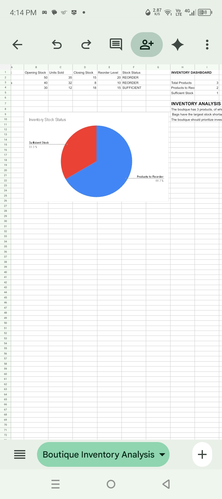

BOUTIQUE INVENTORY ANALYSIS

## PROJECT OVERVIEW

This project focuses on analyzing boutique inventory to monitor stock levels, identify products requiring restocking, and support informed business decisions.

---

## 1. PROJECT OBJECTIVES

- Calculate closing stock for each product.
- Compare available stock against reorder levels.
- Identify products that require restocking.
- Improve inventory monitoring and purchasing decisions.

## 2. TOOLS USED

- Google Sheets: Data entry, calculations, inventory analysis, and dashboard creation.
- GitHub: Project storage and portfolio presentation.

## 3. INVENTORY ANALYSIS

Product| Opening Stock| Units Sold| Closing Stock| Reorder Level| Status
Bags| 50| 35| 15| 20| REORDER
Dresses| 40| 32| 8| 10| REORDER
Shoes| 30| 12| 18| 15| SUFFICIENT

## 4. KEY FINDINGS

- Bags: 15 units remaining, 5 below the reorder level.
- Dresses: 8 units remaining, 2 below the reorder level.
- Shoes: 18 units remaining, 3 above the reorder level.
- Overall: 2 products require restocking out of 3 analyzed.

## 5. DASHBOARD SUMMARY

- Total Products: 3
- Products Requiring Reorder: 2
- Products with Sufficient Stock: 1

## 6. BUSINESS RECOMMENDATIONS

1. Prioritize restocking Bags because they have the largest stock shortage.
2. Restock Dresses to prevent possible stock shortages.
3. Continue monitoring Shoes because their stock is currently sufficient.
4. Review inventory regularly to support timely purchasing decisions.

## 7. SKILLS DEMONSTRATED

- Data entry and organization
- Spreadsheet formulas and calculations
- Inventory analysis
- Data interpretation
- Business reporting
- Dashboard creation
- GitHub portfolio management

---

## 8. PROJECT SCREENSHOT

---

## 9. CONCLUSION

This project demonstrates how data analysis can help a boutique monitor inventory, identify restocking needs, and make better purchasing decisions.

Project completed using Google Sheets and GitHub.
