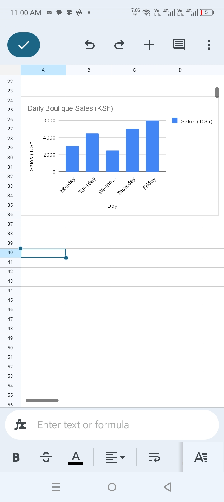

Daily Sales Analysis

Project Overview

This project analyzes five days of boutique sales using Google Sheets.

Objectives

- Calculate total and average daily sales.
- Identify the highest and lowest sales days.
- Compare daily sales against a target.
- Calculate sales percentages and performance indicators.
- Develop business insights and recommendations.

Tools Used

- Google Sheets
- Spreadsheet formulas
- Data analysis
- Charts and visualizations

Key Findings

- Total recorded sales: KSh 21,000.
- Average daily sales: KSh 4,200.
- Highest sales: Friday, KSh 6,000.
- Lowest sales: Wednesday, KSh 2,500.
- Sales target achievement: 60% of recorded days.

Limitations

The analysis covers only five days. More data is needed to establish long-term sales patterns.

Skills Demonstrated

Data analysis, spreadsheet formulas, percentage calculations, performance monitoring, visualization, and business reporting.
## Daily Sales Chart

