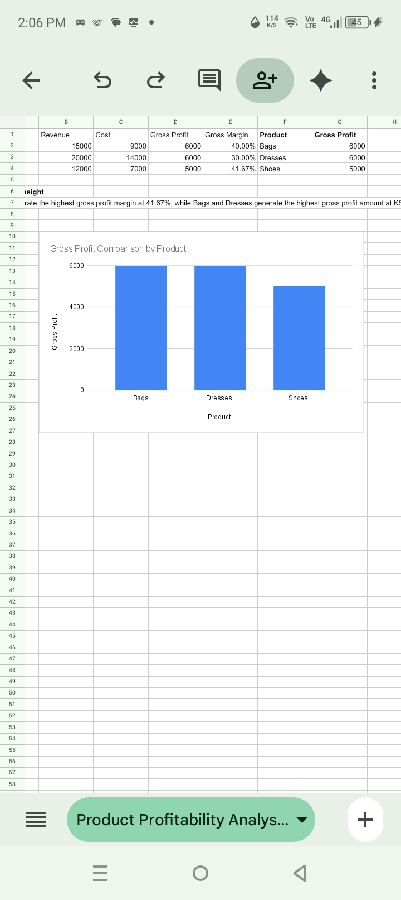

# PRODUCT PROFITABILITY ANALYSIS
# PROJECT OVERVIEW

This project analyzes the profitability of different boutique products to understand revenue, costs, gross profit, and profit margins. The aim is to identify which products contribute most to business profitability.

## 1. PROJECT OBJECTIVES

- Calculate total revenue for each product.
- Determine the cost and gross profit.
- Calculate gross profit margins.
- Compare product profitability.
- Provide recommendations to support better business decisions.

### 2. TOOLS USED

- Google Sheets: Data entry, calculations, analysis, and chart creation.
- GitHub: Project storage and portfolio presentation.

### 3. PROFITABILITY ANALYSIS

Product| Revenue (KSh)| Cost (KSh)| Gross Profit (KSh)| Profit Margin
Bags| 15,000| 9,000| 6,000| 40%
Dresses| 20,000| 14,000| 6,000| 30%
Shoes| 12,000| 7,000| 5,000| 41.67%

### 4. KEY FINDINGS

- Dresses: Generated the highest revenue at KSh 20,000.
- Bags: Generated KSh 6,000 gross profit with a 40% profit margin.
- Shoes: Recorded the highest profit margin at 41.67%.
- Overall: High revenue does not necessarily mean the highest profit margin.

### 5. BUSINESS RECOMMENDATIONS

1. Maintain a focus on Shoes because they have the highest profit margin.
2. Review the costs associated with Dresses to explore opportunities to improve their profit margin.
3. Continue monitoring Bags because they generate strong gross profit.
4. Regularly compare revenue, costs, and profit margins when making purchasing decisions.

### 6. SKILLS DEMONSTRATED

- Data entry and organization
- Spreadsheet formulas and calculations
- Gross profit analysis
- Profit margin calculations
- Data visualization
- Business interpretation
- GitHub portfolio management

### 7. PROJECT SCREENSHOT

Screenshot File: "Screenshot_20261104-140657.jpg"

### 8. CONCLUSION

This project demonstrates how data analysis can help a boutique evaluate product profitability, understand profit margins, and make informed business decisions.

Project completed using Google Sheets and GitHub.
