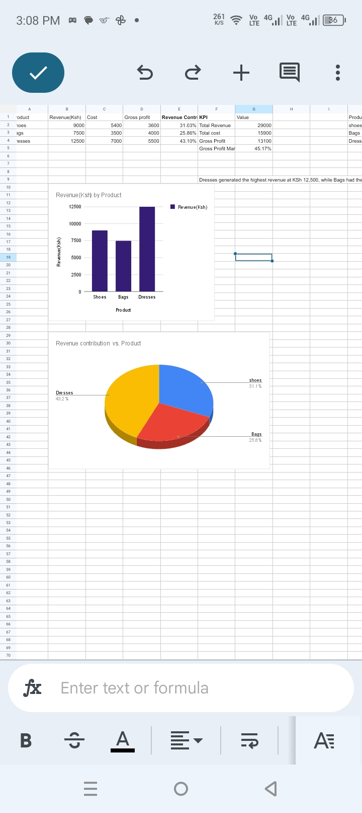

# Boutique_sales_analysis
Boutique sales analysis using Python, Pandas, SQL and google sheets

Tools Used

- Python
- Pandas
- SQL
- Google Colab
- Google Sheets

Key Findings

- Total revenue: KSh 29,000
- Total cost: KSh 15,900
- Total gross profit: KSh 13,100
- Overall gross profit margin: 45.17%
- Dresses generated the highest revenue and gross profit.
- Bags had the highest gross profit margin at approximately 53.33%.

Business Recommendations

- Monitor demand for dresses because they generated the highest revenue and gross profit in this sample.
- Review bags pricing and costs because bags had the highest gross profit margin.
- Track sales and costs regularly to support better business decisions.

Limitations

This project uses a small sample dataset. The results are illustrative and may not represent the performance of a real boutique. Gross profit does not include operating expenses.

Conclusion

This project demonstrates how data analysis tools can turn sales records into useful business insights.

Sales Chart

The pie chart below visualizes the distribution of product sales in my boutique sales analysis projects.

